# Squad Scout architecture

How the system fits together, with most of the detail on `fpl_data_service`.
State as of 2026-10-10. If this disagrees with the code, the code wins.

> **Viewing the diagrams.** They're written in [Mermaid](https://mermaid.js.org/).
> GitHub renders them automatically. In VS Code, install the "Markdown Preview
> Mermaid Support" extension and open the preview (Ctrl+Shift+V).

Contents:

1. [The whole system](#1-the-whole-system)
2. [Inside the data service: packages and layers](#2-inside-the-data-service-packages-and-layers)
3. [Where each piece of data comes from, and how fresh it is](#3-where-each-piece-of-data-comes-from-and-how-fresh-it-is)
4. [Startup and the background refresh](#4-startup-and-the-background-refresh)
5. [Request flows](#5-request-flows)
6. [The database](#6-the-database)
7. [The verifier and the optimizer](#7-the-verifier-and-the-optimizer)
8. [Which RPCs answer which questions](#8-which-rpcs-answer-which-questions)
9. [Errors](#9-errors)
10. [Testing without the internet](#10-testing-without-the-internet)

---

## 1. The whole system

Three programs on one machine, plus the public FPL API.

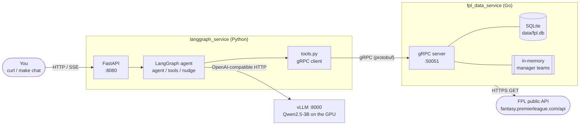

| Program | Job | Talks |
|---|---|---|
| `langgraph_service` | Runs the conversation: asks the model what to do, runs the tools it asks for | HTTP in, gRPC and HTTP out |
| vLLM | Runs the language model | OpenAI-style HTTP |
| `fpl_data_service` | Owns all FPL data: downloads it, caches it, answers questions about it, checks transfers | gRPC in, HTTPS out |

The contract between Python and Go is
[`proto/squadscout/v1/fpl.proto`](../proto/squadscout/v1/fpl.proto).
`make proto` generates the Go server interface and the Python client from it.

**Current gap:** the agent's tools only use `SearchPlayers` and `GetFixtures`.
The other eight RPCs exist and are tested, but the agent can't call them yet.

---

## 2. Inside the data service: packages and layers

Each box is a Go package under `fpl_data_service/internal/` (or `cmd/`).
Arrows mean "imports / calls". The layers only call downwards.

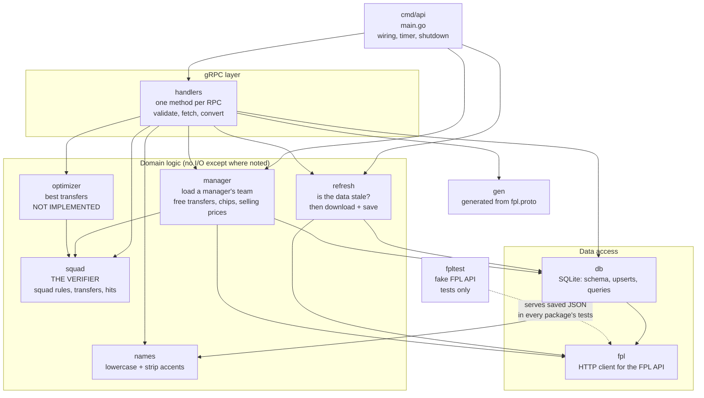

What lives where:

| Package | Files | Responsibility |
|---|---|---|
| `cmd/api` | `main.go` | Opens the database, builds the refresher and manager loader, registers the gRPC service, runs the refresh timer, shuts down cleanly |
| `handlers` | `service.go` shared helpers, `players.go`, `fixtures.go`, `stats.go`, `manager.go`, `transfers.go`, `outlook.go`, `convert.go` | The 10 RPCs. Validate input, call the layers below, convert rows to protobuf, map failures to gRPC codes |
| `refresh` | `refresh.go` | The single freshness rule (`ifStale`) for bootstrap, fixtures and per-player history |
| `manager` | `manager.go` downloading + cache, `rules.go` pure FPL rules | A manager's team: Free Hit revert, free-transfer estimate, chips left, selling prices |
| `squad` | `squad.go` | The verifier: FPL squad rules, applying transfers, hit cost. Pure functions |
| `optimizer` | `optimizer.go` | Types and design for transfer search; `Suggest` returns `ErrNotImplemented` |
| `names` | `names.go` | `Normalize`: "Ødegaard" → "odegaard" |
| `db` | one file per kind of data | SQLite schema (versioned), upserts, queries. Returns its own row types, never protobuf |
| `fpl` | `client.go`, `entry.go` | Downloads and decodes FPL JSON. No storage, no decisions |
| `fpltest` | `fpltest.go` | Fake FPL API for tests, serving `internal/fpl/testdata/*.json` |

Two design rules hold throughout:

- **`db` never imports gRPC code** and **`squad` / `optimizer` never do I/O.** Each
  layer can be tested on its own, and the verifier is cheap enough for the
  optimizer to call thousands of times.
- **Arithmetic happens in Go, not in the model.** Budgets, hits, selling prices,
  totals and rule checks are all computed here, because a 3B model gets sums wrong.

---

## 3. Where each piece of data comes from, and how fresh it is

There are three caches with different lifetimes.

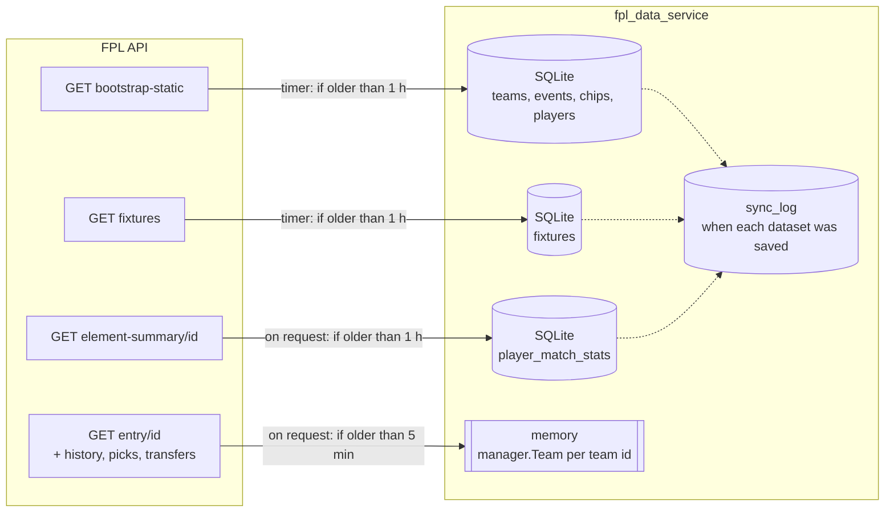

| Data | Source | Stored in | Refreshed | If the FPL API is down |
|---|---|---|---|---|
| Teams, gameweeks, chip rules, players (prices, form, news, expected points, transfer counts) | `/bootstrap-static/` (~3 MB) | SQLite | Timer checks every 10 min, downloads if > 1 h old | Old copy served; retry in 1 min |
| All 380 fixtures with difficulty | `/fixtures/` | SQLite | Same timer, right after bootstrap (it needs the teams) | Old copy served |
| One player's match history | `/element-summary/{id}/` | SQLite | When a request needs it and it's > 1 h old | Old copy served; `Unavailable` if never downloaded |
| One manager's team | `/entry/{id}/` + `/history/` + `/picks/` + `/transfers/` | Memory | When requested and > 5 min old | `Unavailable` |

`sync_log` holds one timestamp per dataset (`bootstrap`, `fixtures`,
`element-summary/12`, …). It's written **in the same transaction** as the data,
so it can never claim a download that didn't save.

**Schema versions.** `db.go` has `schemaVersion`. When `schema.sql` changes,
bump it: on the next start `Open` sees the old number in SQLite's
`PRAGMA user_version`, drops every table and rebuilds them. That's safe because
everything is re-downloadable. Until the first refresh succeeds, the service has
no data; that's why failed refreshes retry after 1 minute.

---

## 4. Startup and the background refresh

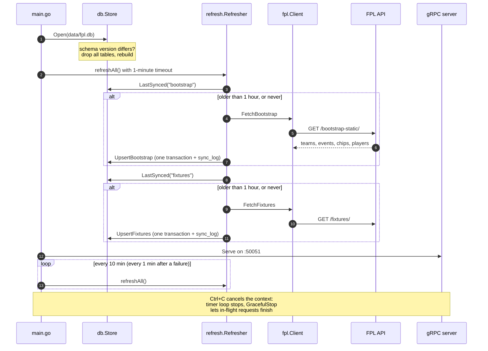

---

## 5. Request flows

### 5a. A player question: `GetPlayerRecentForm`

Histories are downloaded per player, the first time someone asks about him.

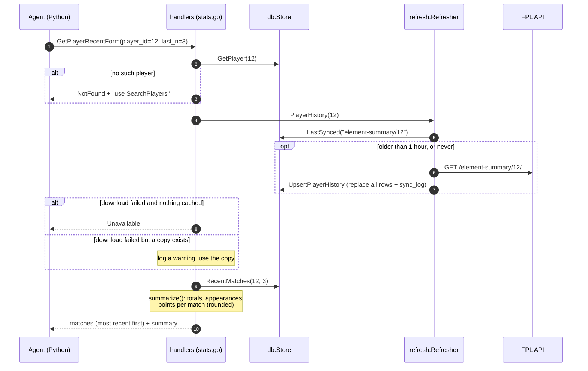

### 5b. A manager question: `GetManagerTeam`

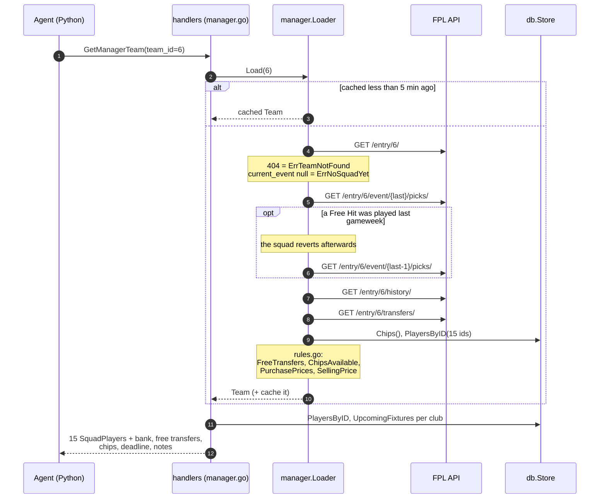

### 5c. Checking transfers: `EvaluateTransfers`

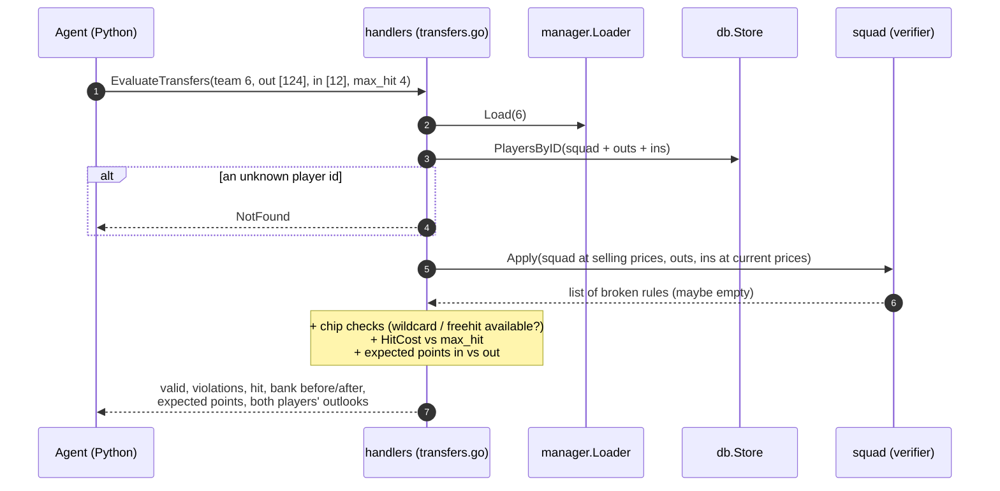

Rule breaks are **answers, not errors**: "you'd have 4 Arsenal players" comes back
as `valid: false` with a violation the agent can explain. gRPC errors are kept for
requests that can't be evaluated at all.

---

## 6. The database

`internal/db/schema.sql`, schema version 3.

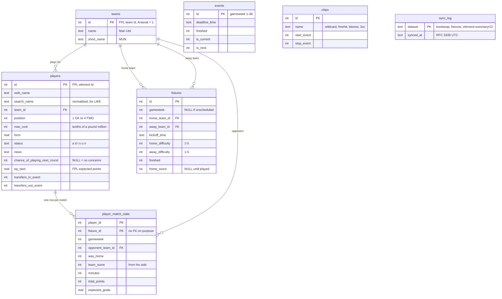

(Only the main columns are shown; `players` and `player_match_stats` have
more stats.) Notes:

- `player_match_stats` is keyed by **(player, fixture)**, not (player, gameweek),
  because a team can play twice in a double gameweek.
- `events`, `chips` and `sync_log` stand alone: they're looked up, not joined.
- Foreign keys are enforced, so teams must be saved before players and fixtures.
  Each upsert runs in one transaction: all of it saves, or none of it.

---

## 7. The verifier and the optimizer

### The verifier (`internal/squad`): implemented

`HitCost(transfers, free, chip)` is separate: 4 points per transfer beyond the
free ones, or 0 with a Wildcard or Free Hit.

### The optimizer (`internal/optimizer`): wired, not implemented

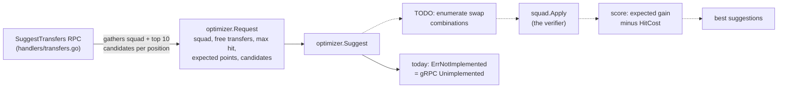

Dashed arrows are the planned path (described in `optimizer.go`); the solid
path is what runs today. Everything before `Suggest` is already built, so
implementing the optimizer means writing that one function.

---

## 8. Which RPCs answer which questions

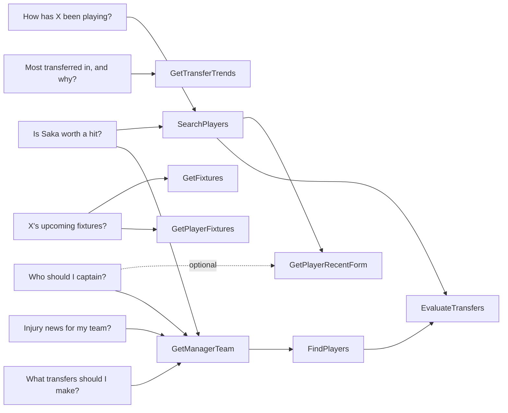

All 10 RPCs:

| RPC | Answers | Data from |
|---|---|---|
| `SearchPlayers` | Players by name, best first, with season stats, availability, news, expected points | SQLite (bootstrap) |
| `FindPlayers` | Players by position / price / availability, sorted by a measure, with next fixtures | SQLite (bootstrap, fixtures) |
| `GetTransferTrends` | Most transferred in or out since the last deadline, with next fixtures | SQLite (bootstrap, fixtures) |
| `GetPlayerRecentForm` | Last N matches + totals | SQLite (history, on demand) |
| `GetPlayerGameweekStats` | One gameweek's stats (totals + each match) | SQLite (history, on demand) |
| `GetPlayerFixtures` | Next fixtures from his team's side + expected points next gameweek | SQLite (fixtures, bootstrap) |
| `GetFixtures` | A team's next fixtures, by id or name | SQLite (fixtures) |
| `GetManagerTeam` | Squad, bank, free transfers, chips, deadline, caveats | Memory (manager) + SQLite |
| `EvaluateTransfers` | Is this set of transfers allowed, what it costs, expected gain | Memory + SQLite + verifier |
| `SuggestTransfers` | Not implemented yet | (wired to the optimizer) |

---

## 9. Errors

Every handler returns one of these gRPC codes. The Python tools turn any error
into an `ERROR: ...` string so the model can tell the user what went wrong.
Messages include a hint for recovering where one exists.

| Code | Meaning | Example |
|---|---|---|
| `InvalidArgument` | The request itself is malformed | empty name, `player_id` 0, negative `max_price` |
| `NotFound` | Well-formed, but no such thing | unknown player or team id, unknown team name, a gameweek he didn't play |
| `FailedPrecondition` | Exists, but can't be used yet | a team created after the last deadline |
| `Unavailable` | FPL API down and nothing cached | first request for a player's history while FPL is down |
| `Internal` | Our bug or a database failure | (logged with details) |
| `Unimplemented` | Not built yet | `SuggestTransfers` |

Squad-rule breaks in `EvaluateTransfers` are **not** errors; see 5c.

---

## 10. Testing without the internet

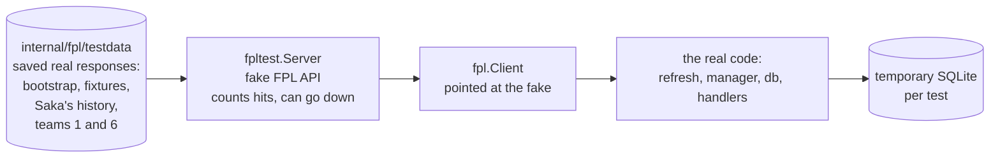

- `make test` runs about 100 Go tests and the Python tests, with no network,
  GPU or servers needed.
- The saved data was chosen to cover tricky cases: team 1 played a **Free Hit**
  the week before; team 6 has **3 Arsenal and 3 Chelsea players** (so buying
  Saka breaks the club limit); Saka's history includes away games, so the
  score must be flipped to his side.
- `squad`, `names` and `manager/rules.go` are pure functions, tested with
  made-up inputs (table-driven tests).
- To refresh the saved data, download the same URLs again into
  `internal/fpl/testdata/`. The expected values in the tests will change with it.
