# Squad Scout architecture

How the system fits together, with most of the detail on `fpl_data_service`.
State as of 2026-10-25. The data service is Python (it was ported from Go; the Go version is in `legacy/`). If this disagrees with the code, the code wins.

> **Viewing the diagrams.** They're written in [Mermaid](https://mermaid.js.org/).
> GitHub renders them automatically. In VS Code, install the "Markdown Preview
> Mermaid Support" extension and open the preview (Ctrl+Shift+V).

Contents:

1. [The whole system](#1-the-whole-system)
2. [Inside the data service: packages and layers](#2-inside-the-data-service-packages-and-layers)
3. [Where each piece of data comes from, and how fresh it is](#3-where-each-piece-of-data-comes-from-and-how-fresh-it-is)
4. [Startup and the background refresh](#4-startup-and-the-background-refresh)
5. [Request flows](#5-request-flows)
6. [The database](#6-the-database)
7. [The verifier and the optimizer](#7-the-verifier-and-the-optimizer)
8. [Which RPCs answer which questions](#8-which-rpcs-answer-which-questions)
9. [Errors](#9-errors)
10. [Testing without the internet](#10-testing-without-the-internet)
11. [Porting notes: Go to Python](#11-porting-notes-go-to-python)

---

## 1. The whole system

Three programs on one machine, plus the public FPL API.

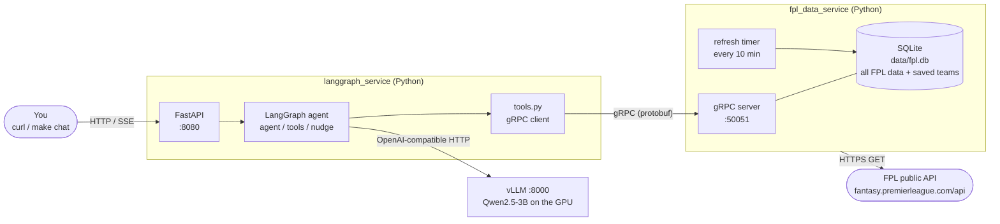

| Program | Job | Talks |
|---|---|---|
| `langgraph_service` | Runs the conversation: asks the model what to do, runs the tools it asks for | HTTP in, gRPC and HTTP out |
| vLLM | Runs the language model | OpenAI-style HTTP |
| `fpl_data_service` | Owns all FPL data: downloads it in the background, keeps it in SQLite, answers questions about it, checks transfers | gRPC in, HTTPS out |

The contract between the agent and the data service is
[`proto/squadscout/v1/fpl.proto`](../proto/squadscout/v1/fpl.proto).
`make proto` generates the server code (data service) and the client code (agent) from it.

**Requests are answered from SQLite.** The only FPL call made while answering
a request is downloading a manager's team, the first time it's asked about in
a gameweek (see [section 3](#3-where-each-piece-of-data-comes-from-and-how-fresh-it-is)).

**Current gap:** the agent's tools only use `SearchPlayers` and `GetFixtures`.
The other eight RPCs exist and are tested, but the agent can't call them yet.

---

## 2. Inside the data service: packages and layers

Each box is a module or package under `fpl_data_service/src/fpl_data/`.
Arrows mean "imports / calls". The layers only call downwards.

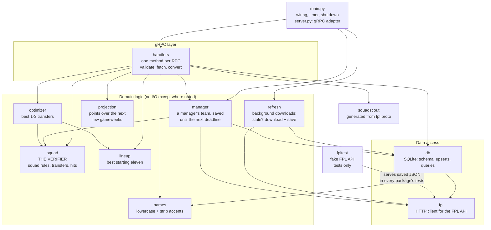

What lives where:

| Module / package | Files | Responsibility |
|---|---|---|
| `main.py`, `server.py` | | `main.py` opens the database, builds the refresher and manager loader, starts the gRPC server, runs the refresh timer, shuts down cleanly. `server.py` is the thin gRPC adapter: CamelCase RPC names → `FplService` methods, `ServiceError` → gRPC status, plus health check and reflection |
| `handlers/` | `service.py` (start here), `base.py` shared helpers, `players.py`, `fixtures.py`, `stats.py`, `manager_team.py`, `transfers.py`, `projector.py` (gathers a player's data for the projection), `fixture_cache.py`, `convert.py`, `errors.py` | The 10 RPCs. Plain async methods: validate input, call the layers below, convert rows to protobuf, raise `ServiceError` with a gRPC code |
| `refresh.py` | | Background downloads of bootstrap, fixtures and gameweek stats, with one freshness rule (`_if_stale`) |
| `manager/` | `loader.py` downloading + saving, `rules.py` pure FPL rules | A manager's team: Free Hit revert, free-transfer count, chips left, selling prices (from price history); saved in SQLite until the next deadline |
| `squad.py` | | The verifier: FPL squad rules, applying transfers, hit cost. Pure functions |
| `lineup.py` | | The best starting eleven of a squad by projected points (only 11 of 15 score). Pure |
| `projection.py` | | Expected points over the next few gameweeks from recent minutes and points, availability and fixture difficulty. Pure; backtested constants |
| `optimizer.py` | | Tries every 1-3 swap, checks each with the verifier, ranks by the change in the best eleven minus the hit. Pure, so it runs in a worker thread |
| `names.py` | | `normalize`: "Ødegaard" → "odegaard" |
| `db/` | one module per kind of data | SQLite schema (versioned), upserts, queries. Returns its own row dataclasses, never protobuf |
| `fpl/` | `client.py`, `models.py` | Downloads FPL JSON and decodes it into Pydantic models (which also convert FPL's `"6.2"` strings and nulls). Limits requests in flight and obeys 429 `Retry-After`. No storage, no decisions |
| `tests/fake_fpl.py` | | Fake FPL API for tests (an `httpx.MockTransport`), serving `tests/testdata/*.json` |

Two design rules hold throughout:

- **`db` never imports gRPC code** and **`squad` / `optimizer` never do I/O.** Each
  layer can be tested on its own, and the verifier is cheap enough for the
  optimizer to call thousands of times.
- **Arithmetic happens in the data service, not in the model.** Budgets, hits, selling prices,
  totals and rule checks are all computed here, because a 3B model gets sums wrong.

---

## 3. Where each piece of data comes from, and how fresh it is

Everything lives in SQLite. Three kinds of data are downloaded by the
background timer; managers' teams are downloaded when first asked for.

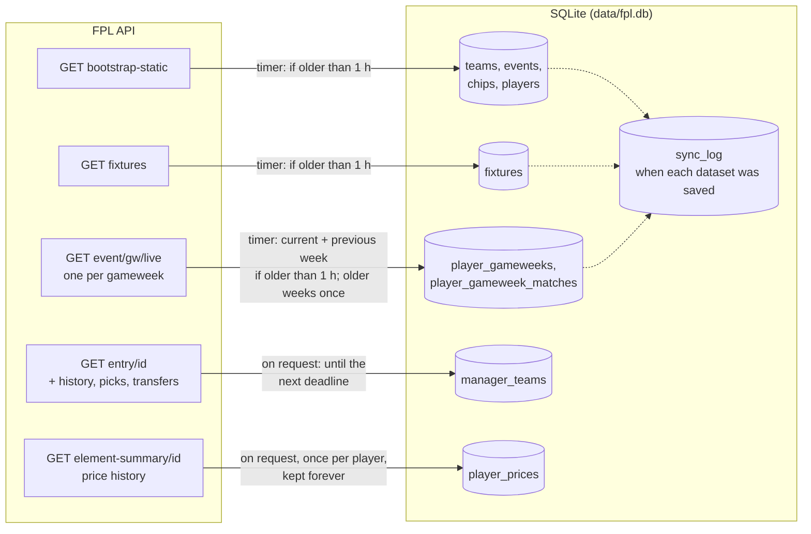

| Data | Source | Refreshed | If the FPL API is down |
|---|---|---|---|
| Teams, gameweeks, chip rules, players (prices, form, news, expected points, transfer counts) | `/bootstrap-static/` (~3 MB) | Timer checks every 10 min, downloads if > 1 h old | Old copy served; retry in 1 min |
| All 380 fixtures with difficulty | `/fixtures/` | Same timer, right after bootstrap (it needs the teams) | Old copy served |
| Every player's stats, per gameweek | `/event/{gw}/live/` (~0.5 MB each, all players) | Same timer. The current and previous gameweeks every hour (points, bonus and corrections still change); older ones once, then never again | Old copy served |
| One manager's team | `/entry/{id}/` + `/history/` + `/picks/` + `/transfers/` (the last three fetched at the same time) | When first requested, then saved until the next deadline (FPL hides new picks until then) | Saved copy served with a warning note; `Unavailable` if never downloaded |
| A player's price in each gameweek | `/element-summary/{id}/` | Only for players a manager has held since the start (to learn their purchase price); a past price never changes, so each is kept forever | That player's selling price falls back to an estimate (his current price), flagged |

`sync_log` holds one timestamp per downloaded dataset (`bootstrap`, `fixtures`,
`event-live/5`, …). It's written **in the same transaction** as the data, so it
can never claim a download that didn't save. Each gameweek is a separate
dataset, so an interrupted first run carries on where it stopped.

Manager teams track freshness themselves: each row in `manager_teams` has a
`valid_until` (the next deadline). A first request for a team makes 6 or more
FPL requests, and takes about 2-3 seconds live; every later request that
gameweek is instant, even after a restart.

**Being polite to FPL.** The client never has more than 4 requests in flight. On
HTTP 429 ("too many requests") it waits as long as the `Retry-After` header
says (up to 10 seconds, at most twice). If FPL asks for longer, it raises
`RateLimitedError`, and the background refresh then waits that long before its
next attempt.

**Why per gameweek, not per player?** `/event/{gw}/live/` returns every player's
stats for one week in one response. A whole season so far is at most 38
downloads, instead of one per player (~700), and finished weeks never need
downloading again. FPL only splits minutes and points per match; other stats
are weekly totals, which matters only in a double gameweek.

**Schema versions.** `db/store.py` has `SCHEMA_VERSION`. When `schema.sql` changes,
bump it: on the next start `Open` sees the old number in SQLite's
`PRAGMA user_version`, drops every table and rebuilds them. That's safe because
everything is re-downloadable (saved manager teams are simply downloaded again).
Until the first refresh succeeds, the service has no data; that's why failed
refreshes retry after 1 minute.

---

## 4. Startup and the background refresh

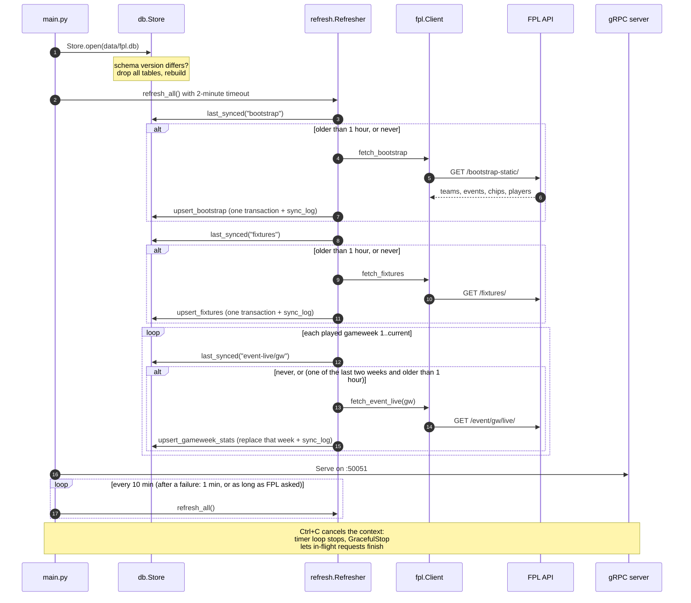

---

## 5. Request flows

### 5a. A player question: `GetPlayerRecentForm`

Answered from SQLite alone; the background refresh has already downloaded
every gameweek.

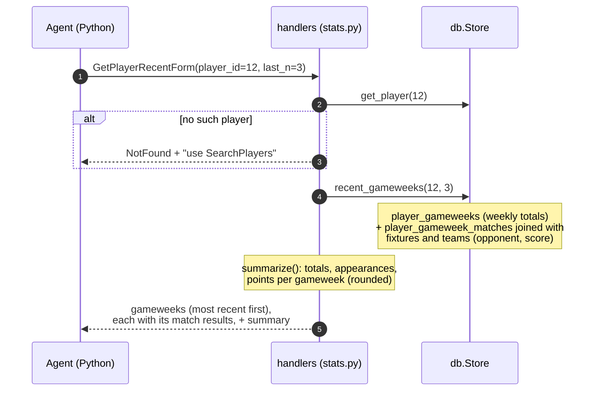

### 5b. A manager question: `GetManagerTeam`

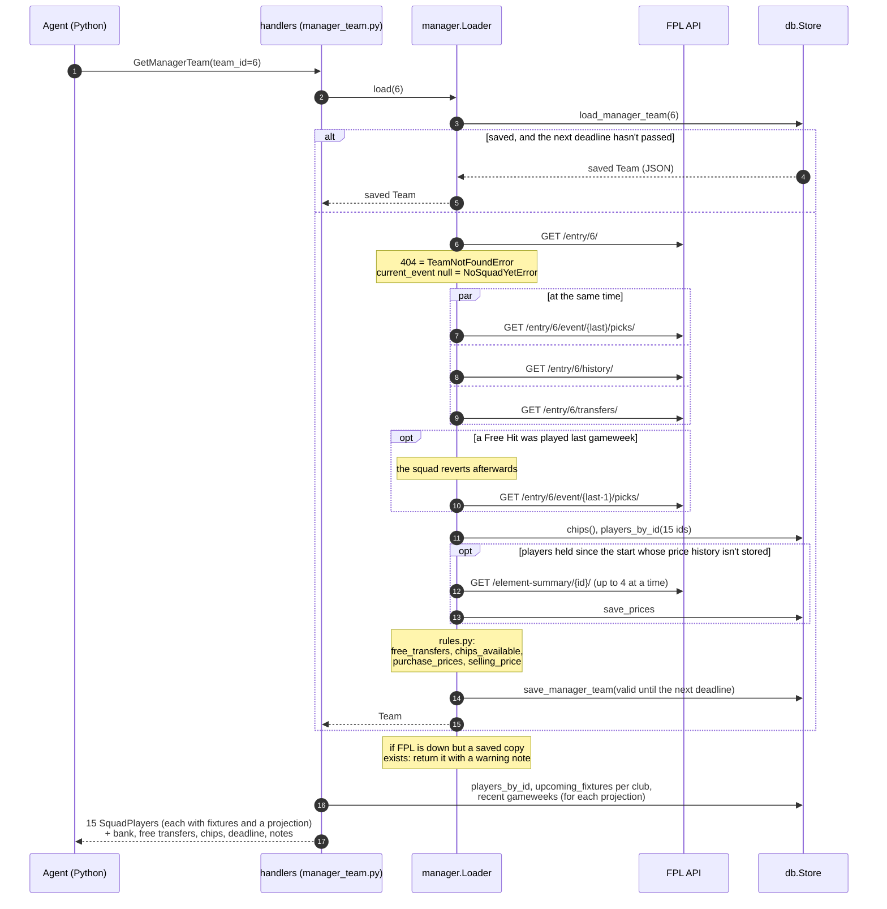

### 5c. Checking transfers: `EvaluateTransfers`

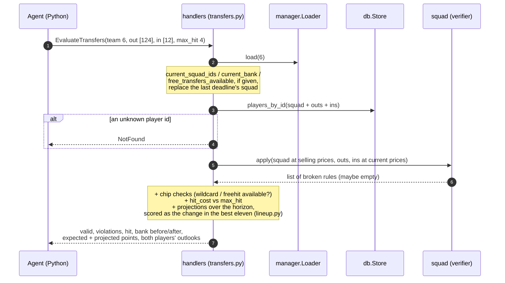

Rule breaks are **answers, not errors**: "you'd have 4 Arsenal players" comes back
as `valid: false` with a violation the agent can explain. gRPC errors are kept for
requests that can't be evaluated at all.

### 5d. Finding the best transfers: `SuggestTransfers`

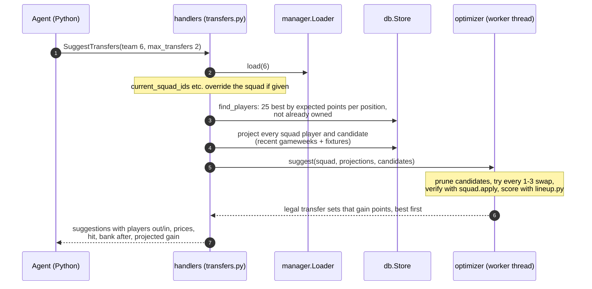

Everything the optimizer needs is handed to it as plain values, and it does no
database or network calls, which is why it can safely run in a worker thread
(`asyncio.to_thread`) without blocking other requests.

---

## 6. The database

`src/fpl_data/db/schema.sql`, schema version 5.

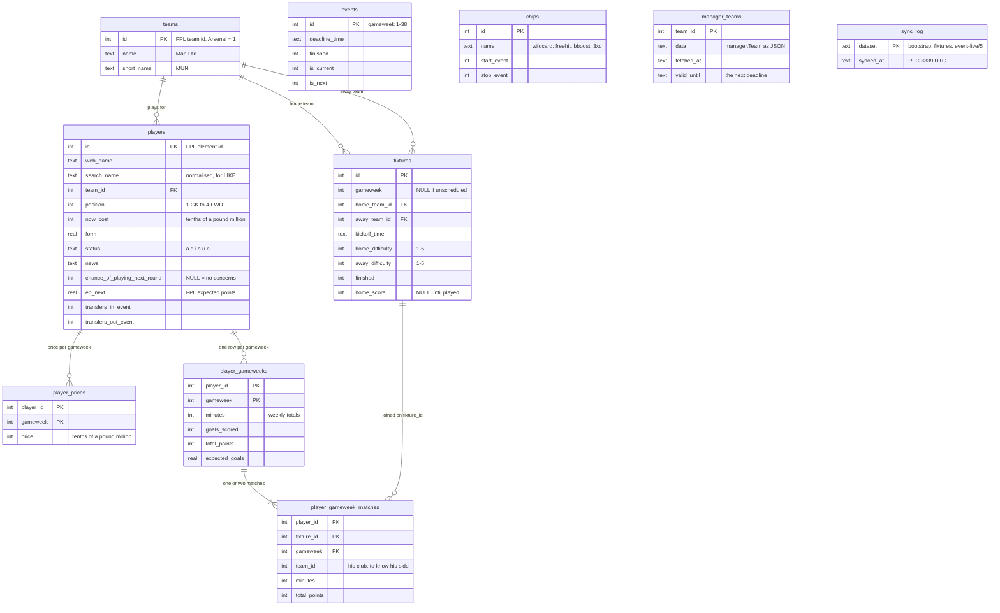

(Only the main columns are shown; `players` and `player_gameweeks` have more
stats.) Notes:

- `player_gameweeks` holds FPL's **weekly totals**; `player_gameweek_matches`
  holds the one or two matches behind each week (FPL only splits minutes and
  points per match). The opponent and score come from joining `fixtures`.
- `fixture_id` deliberately has no foreign key, so the gameweek and fixture
  downloads stay independent.
- `events`, `chips`, `manager_teams` and `sync_log` stand alone: they're looked
  up, not joined.
- Foreign keys are enforced, so teams must be saved before players and fixtures.
  Each upsert runs in one transaction: all of it saves, or none of it.

---

## 7. The verifier and the optimizer

### The verifier (`squad.py`): implemented

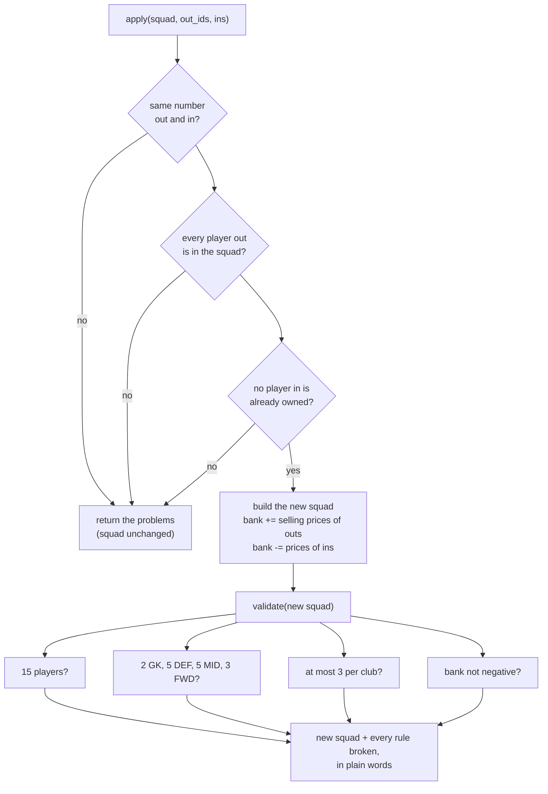

`hit_cost(transfers, free, chip)` is separate: 4 points per transfer beyond the
free ones, or 0 with a Wildcard or Free Hit.

### Scoring: the best starting eleven (`lineup.py`)

Only 11 of a squad's 15 players score, so a transfer is worth the change in the
**best eleven's** projected points, not in the sum of 15. A better substitute
adds nothing; a new player good enough to start gains the difference to whoever
he displaces. The eleven is the best valid formation (1 GK, at least 3 DEF, 2
MID and 1 FWD): 3-4-3, 3-5-2, 4-3-3, 4-4-2, 4-5-1, 5-2-3, 5-3-2 or 5-4-1.

### The optimizer (`optimizer.py`)

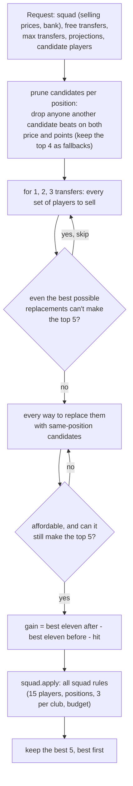

Two safeguards: the pruning can't lose the best answer (a test compares the
optimizer with a plain brute force over 12 random squads and finds the same
best gain), and every suggestion is re-checked by `EvaluateTransfers` in the
tests, which must agree on validity, hit and gain. Typical run time is
0.1 to 0.4 seconds.

---

## 8. Which RPCs answer which questions

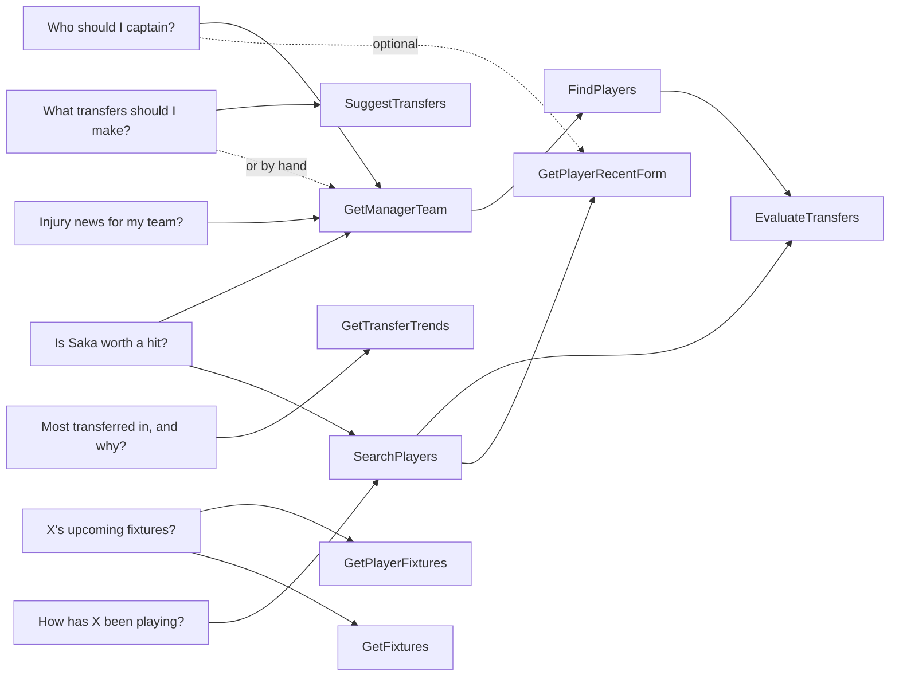

All 10 RPCs:

| RPC | Answers | Data from |
|---|---|---|
| `SearchPlayers` | Players by name, best first, with season stats, availability, news, expected points | SQLite (bootstrap) |
| `FindPlayers` | Players by position / price / availability, sorted by a measure, with next fixtures and a projection | SQLite (bootstrap, fixtures, gameweek stats) |
| `GetTransferTrends` | Most transferred in or out since the last deadline, with next fixtures | SQLite (bootstrap, fixtures) |
| `GetPlayerRecentForm` | Last N gameweeks + totals | SQLite (gameweek stats) |
| `GetPlayerGameweekStats` | One gameweek's stats, with each match's minutes and points | SQLite (gameweek stats) |
| `GetPlayerFixtures` | Next fixtures from his team's side + expected points next gameweek | SQLite (fixtures, bootstrap) |
| `GetFixtures` | A team's next fixtures, by id or name | SQLite (fixtures) |
| `GetManagerTeam` | Squad, bank, free transfers, chips, deadline, caveats | FPL on first request per gameweek, then SQLite |
| `EvaluateTransfers` | Is this set of transfers allowed, what it costs, expected and projected gain (optionally for a squad/bank the manager states) | Same, + the verifier |
| `SuggestTransfers` | The best 1-3 transfers, each already checked against every squad rule | Same + the optimizer |

---

## 9. Errors

Every handler returns one of these gRPC codes. The Python tools turn any error
into an `ERROR: ...` string so the model can tell the user what went wrong.
Messages include a hint for recovering where one exists.

| Code | Meaning | Example |
|---|---|---|
| `InvalidArgument` | The request itself is malformed | empty name, `player_id` 0, negative `max_price` |
| `NotFound` | Well-formed, but no such thing | unknown player or team id, unknown team name, a gameweek he didn't play |
| `FailedPrecondition` | Exists, but can't be used yet | a team created after the last deadline |
| `Unavailable` | FPL API down or rate-limiting, and nothing saved | first request for a manager's team while FPL is down |
| `Internal` | Our bug or a database failure | (logged with details) |

Squad-rule breaks in `EvaluateTransfers` are **not** errors; see 5c.

---

## 10. Testing without the internet

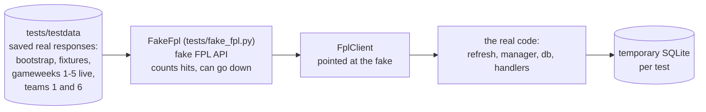

- `make test` runs 255 data-service tests and the 2 agent tests, with no network,
  GPU or servers needed.
- The saved data was chosen to cover tricky cases: team 1 played a **Free Hit**
  the week before; team 6 has **3 Arsenal and 3 Chelsea players** (so buying
  Saka breaks the club limit); Saka's gameweeks include away games, so the
  score must be flipped to his side.
- The manager loader's clock is a field, so tests can move "now" past a deadline
  and check that the saved team is replaced.
- `squad`, `names` and `manager/rules.py` are pure functions, tested with
  made-up inputs (parametrized tests).
- To refresh the saved data, download the same URLs again into
  `tests/testdata/`. The expected values in the tests will change with it.

---

## 11. Porting notes: Go to Python

The data service was first written in Go and then ported (2026-10-14) so the
whole project is one language. The original is in `legacy/fpl_data_service_go/`.
The contract (`fpl.proto`) did not change, so the agent was untouched.

How the pieces map:

| Go | Python |
|---|---|
| `net/http` client, `json:"..."` structs, `parse.go` | `httpx` + Pydantic models (they also convert `"6.2"` strings and nulls) |
| `database/sql` + `modernc.org/sqlite` | stdlib `sqlite3`; `schema.sql` and the SQL queries carried over almost unchanged |
| methods on `*Store`, one file per topic | functions taking the `Store`, one module per topic (`db.players.search(store, ...)`) |
| `(value, ok, err)` returns | `X | None`, and exceptions |
| `status.Error(codes.NotFound, ...)` | `raise ServiceError(StatusCode.NOT_FOUND, ...)`; `server.py` converts |
| goroutine + `time.Ticker`, `context` | an `asyncio` task, `asyncio.timeout` |
| `*int` for nullable numbers | `int | None` (and `HasField()` for protobuf `optional` fields) |
| table-driven tests, `httptest` fake server | `pytest.mark.parametrize`, a fake `httpx.MockTransport` serving the same saved JSON |

How it was checked: the same saved responses and the same expected values in
the tests (161 tests), and 45 requests covering all 10 RPCs and their errors
sent to both services against live FPL data, with the responses compared: all
identical.

Differences worth knowing:

- `grpcurl` shows field names in snake_case (`web_name`) from the Python server
  and camelCase (`webName`) from the Go one; the data is the same.
- Python's `round()` rounds halves to even; `handlers/convert.round2` rounds
  them away from zero like Go's `math.Round`, so sums come out the same.
- All database calls are synchronous and happen on the event loop thread (they
  take milliseconds). That is why one connection is enough, and why no
  transaction may contain an `await`.
